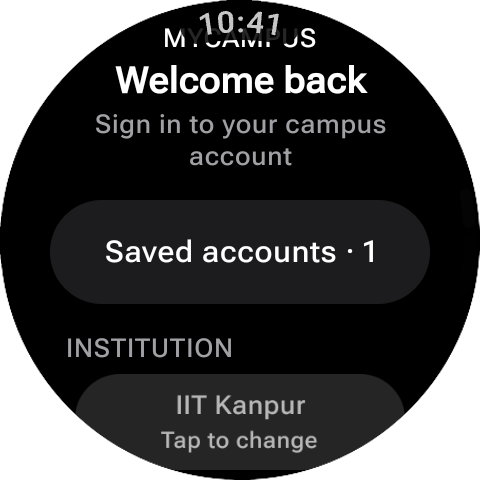
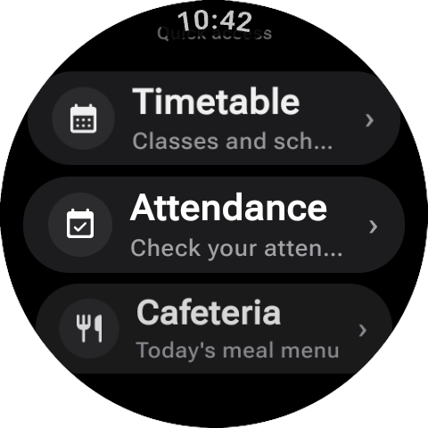
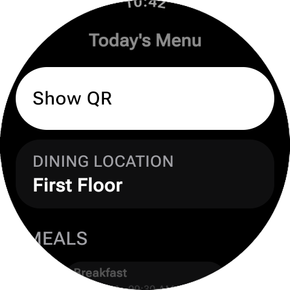
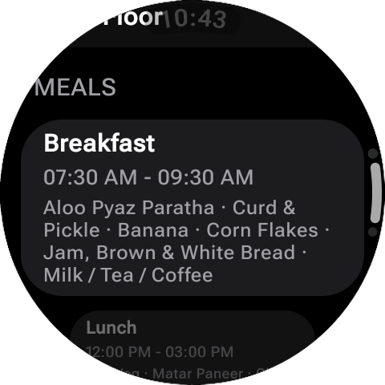
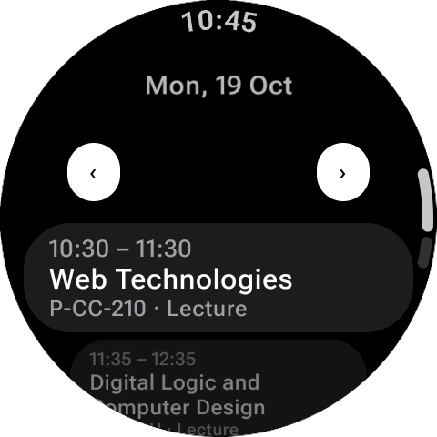

# MyCampus

A Wear OS companion app for students who want quick access to their campus information directly from their smartwatch.

## Features

- **Attendance** — Check your attendance information.
- **Timetable** — View your class schedule from your wrist.
- **Student access** — Access supported campus information after signing in.
- **Watch-friendly interface** — Designed for the small screen and interactions of Wear OS watches.

## Compatibility

- Wear OS smartwatches
- A compatible student account and campus portal are required for supported features.

## Screenshots

Screenshots of the app running on a Wear OS device will be added here.

  
  
  
  
  

## Project Status

MyCampus is an independently developed project. Features and compatibility may vary depending on the campus portal and device.

## License

This project is licensed under the GNU General Public License v3.0. See [LICENSE](LICENSE) for details.
